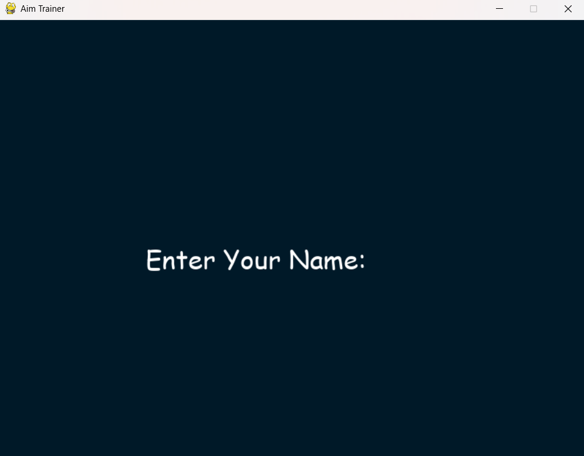
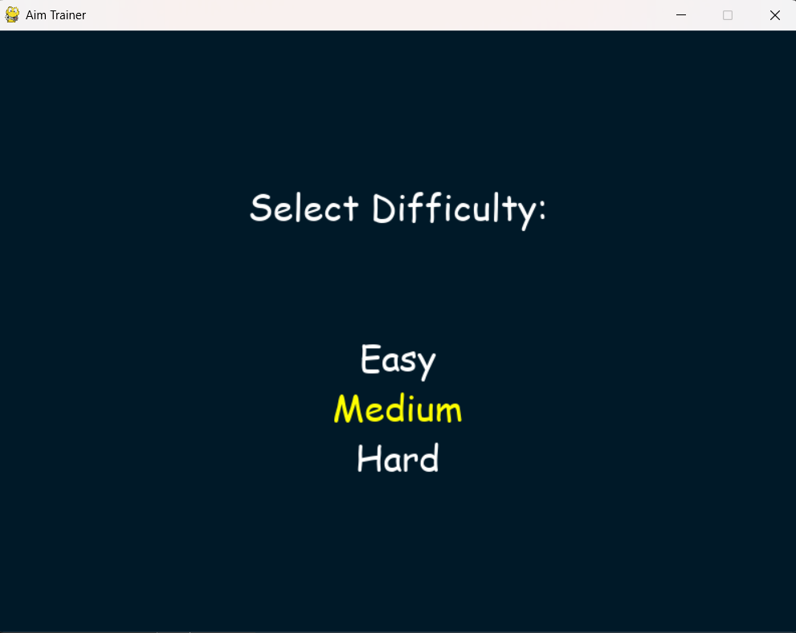
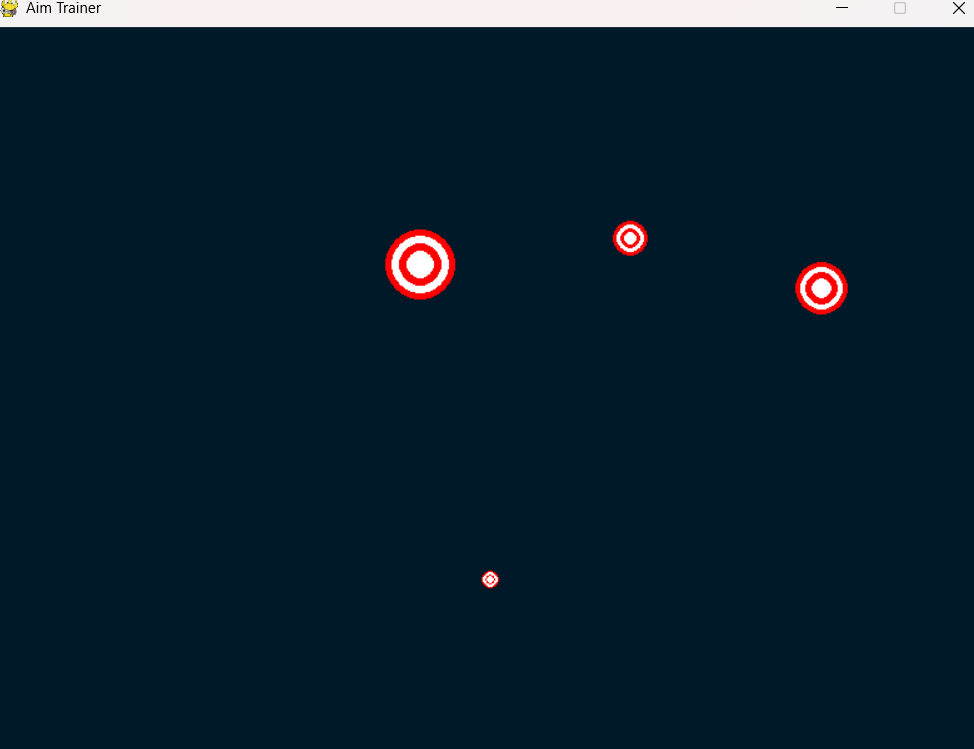
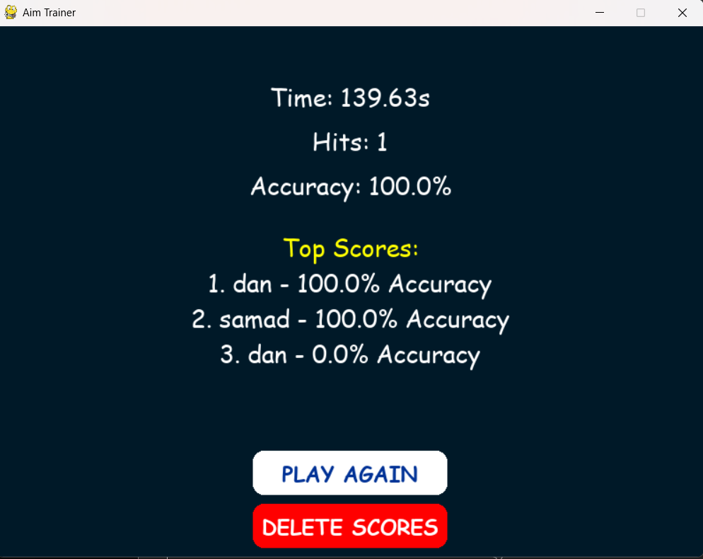

# 🎯 Aim Trainer

A Python + Pygame aim trainer with a MySQL-backed leaderboard. Click targets before they shrink away; three misses ends the run.

> Diploma minor project, 2024. My first project.

| Enter name | Select difficulty |
|---|---|
|  |  |
| **Gameplay** | **Results & leaderboard** |
|  |  |

## Features

- Three difficulty levels: Easy, Medium, Hard (sets spawn speed and target size)
- Targets grow, then shrink; if one disappears before you click it, that's a miss
- Tracks time, hits and accuracy for every run
- Saves every session to MySQL and shows a Top 5 leaderboard
- Play Again and Delete Scores buttons on the results screen

## Tech stack

Python · Pygame · MySQL · mysql-connector-python

## Run it locally

1. Install Python 3.9+ and MySQL.
2. Create the database and table:
   ```
   mysql -u root -p < schema.sql
   ```
3. Install dependencies:
   ```
   pip install -r requirements.txt
   ```
4. Set your database credentials:
   ```
   # Windows (PowerShell)
   $env:DB_USER="your_user"; $env:DB_PASSWORD="your_password"
   # macOS / Linux
   export DB_USER=your_user DB_PASSWORD=your_password
   ```
   Optional: `DB_HOST` (default `localhost`), `DB_NAME` (default `aim_trainer_db`).
5. Run the game:
   ```
   python main.py
   ```

## Controls

Type your name and press Enter · ↑/↓ and Enter to pick difficulty · click targets · Esc to quit from the results screen
